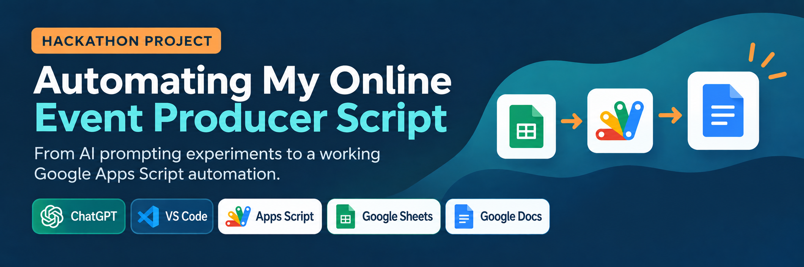

# Hackathon Project: Automating My Online Event Producer Script
An AI-powered automation that helps online event producers streamline event planning, coordination, and delivery.

## 🎬 Watch My Hackathon Project Video

I created a video showcasing my Hackathon journey, from experimenting with AI prompting techniques to building a working Google Apps Script automation.

The video highlights my Google Sheets schedule, AI-assisted coding in VS Code, daily automation trigger, and successfully generated facilitator script.

**[▶ Watch or Download My Hackathon Video](https://github.com/jlee-star/joan-live-event-automation/blob/main/video/Hackathon%20Video.mp4)**

*Note: GitHub may download the video instead of playing it directly in your browser.*

## Project Overview

For my Hackathon project, I wanted to explore how AI and automation could simplify my daily work as an Online Event Producer at O'Reilly.

I started by experimenting with different AI prompting techniques to improve my facilitator scripts. As I worked through the project, I realized I could take things further by automating some of the repetitive tasks I complete before each live event.

My goal was simple: **save time, reduce manual copying and pasting, and improve accuracy.**

## Tools I Used

- ChatGPT — Testing different AI prompting techniques
- O'Reilly Expert Intelligence — Helping generate course registration/recording links
- Visual Studio Code (VS Code) — Using AI assistance to generate JavaScript
- Google Apps Script — Automating my daily facilitator script
- Google Sheets — Storing my course schedule and event information
- Google Docs — Creating my daily facilitator scripts

## What I Built

**YAY! I automated my script!**

Using AI assistance in VS Code, I generated JavaScript code that I copied into Google Apps Script.

My automation pulls the course title, instructor's name, and recording/registration link from my Google Sheets schedule and creates a new facilitator script in Google Docs.

I also configured a daily trigger so the automation runs before my events.

Instead of manually entering the same information each day, the script now handles that part of my preparation.

## How My Automation Works

1. My Google Sheet contains the course titles in column C, instructor names in column D, and registration/recording links in column G.
2. Google Apps Script checks the schedule for the current day and selects the earliest course with a readable start time.
3. The script creates a new copy of my facilitator script template.
4. It replaces the course title, instructor, and `[link]` placeholders with the correct information.
5. A daily trigger runs the automation at approximately 4 AM Pacific Time.

The original Google Doc template stays unchanged.

## My Prompt Engineering Experiments

Before building the automation, I tested three different AI prompting approaches:

| Approach | What I Learned |
|---|---|
| Zero-shot | Quickest approach and produced a reasonable first draft. |
| One-shot | Produced the most useful result by following my existing facilitator script. |
| Decomposition | Provided more structure and control but required more time to prepare. |

**My takeaway:** One-shot prompting worked best for my daily facilitator script because I already had an example of the tone and structure I needed.

## My Automation in Action

These screenshots show how I built and tested my daily facilitator script automation.

### 1. My Google Sheets Course Schedule

My course schedule contains the course titles, instructor names, and recording/registration links that my automation uses to prepare my daily facilitator script.

### 2. My Google Apps Script Code

I used AI assistance in VS Code to generate the JavaScript code, which I copied into Google Apps Script to connect my course schedule to my facilitator script template.

### 3. My Daily Automation Trigger

I configured a daily time-based trigger to run my automation at approximately 4 AM Pacific Time, so my facilitator script is prepared before my events.

### 4. My Automatically Generated Facilitator Script

YAY! It worked! This screenshot shows the new Google Doc created by my automation, with the correct course title, instructor, and recording link automatically populated.

## Project Documentation

I've included my supporting materials so others can see how I developed and tested the automation.

- [Hackathon Project Documentation (PDF)](docs/Hackathon%20Project_%20Automating%20My%20Online%20Event%20Producer%20Script%20-%20Joan.pdf)
- [Google Apps Script Source Code](src/Code.gs)
- [Documentation Folder](docs/)

## What I Learned

This project helped me understand how AI and automation can work together.

AI helped me experiment with the language and structure of my facilitator script, while Google Apps Script helped automate the repetitive work of transferring information from my course schedule into a new document.

I also gained experience using VS Code, working with JavaScript, and testing an automated workflow.

What started as a simple AI prompting experiment turned into something I can actually use in my daily work.

## My Biggest Takeaway

**AI drafts and I judge.**

Even though my automation is working, I still review the generated facilitator script before each event to make sure the course information is correct and the wording sounds natural.

AI and automation help me work more efficiently, but I'm still responsible for the final result.

I'm excited to keep learning and see what else I can automate!

## Project Owner

Joan Lee  
Senior Online Producer, O’Reilly Media

